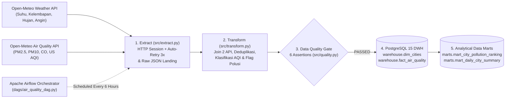
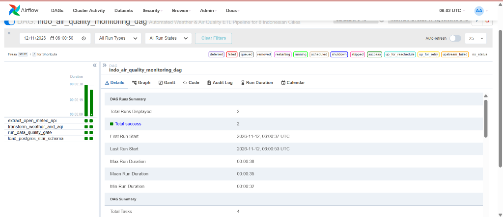
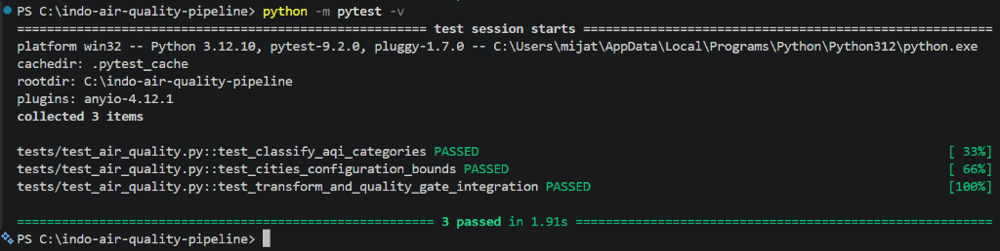
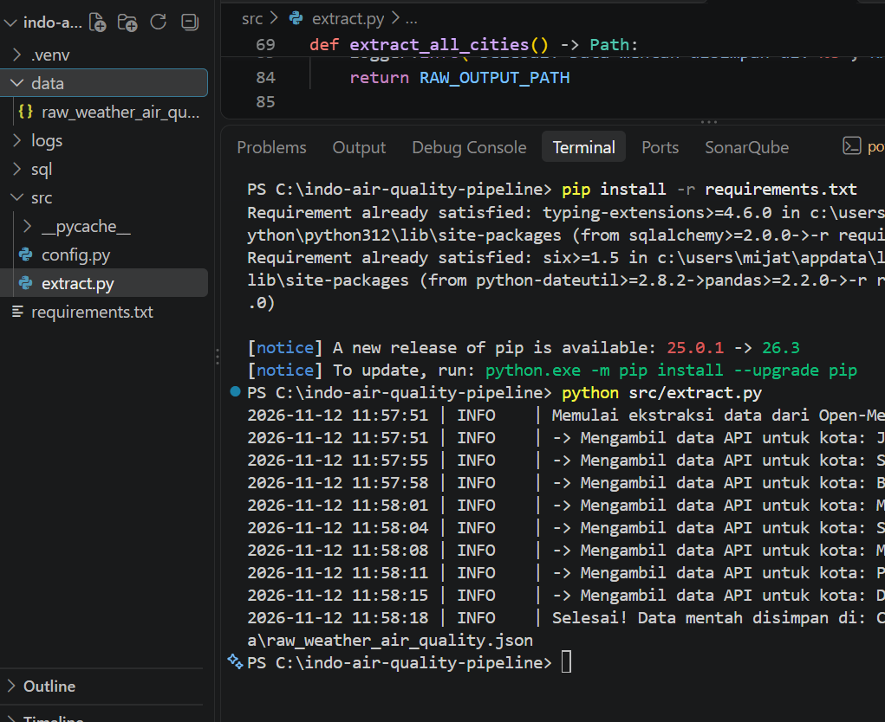

# Indonesia Weather & Air Quality Monitoring Data Pipeline

> **End-to-End Public API ETL Pipeline, PostgreSQL Star Schema Data Warehouse & Apache Airflow Orchestration**  
> Mengekstrak data cuaca dan polusi udara (`PM2.5`, `PM10`, `CO`, `US AQI`) secara *real-time* dari **Open-Meteo REST API** untuk 8 kota besar di Indonesia, melakukan pembersihan & validasi kualitas data menggunakan **Python (Pandas & Pytest)**, menyimpannya ke dalam **PostgreSQL 15 Data Warehouse**, serta menjadwalkannya secara otomatis dengan **Apache Airflow (Docker)**.

---

## 1. Arsitektur Data Pipeline



---

## 2. Fitur Utama Data Engineering

1. **Resilient API Ingestion (`src/extract.py`):**
   - Mengambil data 72 jam terakhir dari 2 endpoint REST API berbeda untuk 8 ibu kota provinsi di Indonesia.
   - Dilengkapi **HTTP Connection Pooling & Exponential Backoff Retry (`urllib3.Retry`)** untuk menangani *network/SSL handshake timeout*, serta mekanisme *Raw JSON Cache Fallback*.
2. **Data Transformation & Business Logic (`src/transform.py`):**
   - Menggabungkan (*inner join*) array JSON cuaca dan polusi udara berdasarkan waktu pengamatan (`observed_at`) dan `city_id`.
   - Menghapus duplikasi `(city_id, observed_at)` serta memvalidasi nilai sensor kosong (`NULL`).
   - Mengklasifikasikan angka `us_aqi` ke dalam kategori kesehatan udara (`Baik`, `Sedang`, `Tidak Sehat bagi Sensitif`, `Tidak Sehat`, `Sangat Tidak Sehat`).
3. **Automated Data Quality Gate & Unit Testing (`src/quality.py` & `tests/test_air_quality.py`):**
   - Memeriksa 6 aturan kualitas data otomatis (keunikan *Primary Key* & *Composite Key*, kelengkapan sensor kritis, kewajaran rentang suhu Indonesia $10^\circ\text{C}\text{–}45^\circ\text{C}$, nilai polusi non-negatif, dan *Foreign Key Integrity*) sebelum pemuatan ke Data Warehouse.
   - Dilengkapi *unit & integration test suite* menggunakan **Pytest**.
4. **Idempotent Star Schema Warehouse (`sql/init_schema.sql` & `src/load.py`):**
   - Memisahkan schema `warehouse` (`dim_cities`, `fact_air_quality`) dan schema `marts` (`mart_city_pollution_ranking`, `mart_daily_city_summary`) di PostgreSQL 15.
5. **Automated Workflow Orchestration (`dags/air_quality_dag.py`):**
   - Menggunakan **Apache Airflow** (`indo_air_quality_monitoring_dag`) untuk menjadwalkan 4 task (`extract_open_meteo_api >> transform_weather_and_aqi >> run_data_quality_gate >> load_postgres_star_schema`) setiap 6 jam secara otomatis.

---

## 3. Hasil Eksekusi & Analisis Data Mart (`marts.mart_city_pollution_ranking`)

Hasil pemantauan 576 jam pengamatan cuaca & polusi udara di 8 kota besar Indonesia:

| Rank | Kota | Provinsi | Jam Dipantau | Avg US AQI | Peak US AQI | Avg PM2.5 (µg/m³) | Avg Suhu (°C) | Avg Kelembapan (%) | Jam Berpolusi |
| ---: | :--- | :--- | ---: | ---: | ---: | ---: | ---: | ---: | ---: |
| 1 | **Jakarta** | DKI Jakarta | 72 | 176.8 | 190 | 88.69 | 28.6 | 77% | 72 |
| 2 | **Bandung** | Jawa Barat | 72 | 169.5 | 182 | 81.97 | 25.1 | 74% | 72 |
| 3 | **Semarang** | Jawa Tengah | 72 | 125.3 | 192 | 38.30 | 28.8 | 77% | 71 |
| 4 | **Surabaya** | Jawa Timur | 72 | 125.2 | 152 | 44.63 | 29.9 | 71% | 65 |
| 5 | **Makassar** | Sulawesi Selatan | 72 | 110.7 | 133 | 37.90 | 29.2 | 73% | 59 |
| 6 | **Medan** | Sumatera Utara | 72 | 93.7 | 121 | 30.75 | 26.1 | 91% | 42 |
| 7 | **Palembang** | Sumatera Selatan | 72 | 82.3 | 87 | 25.50 | 28.0 | 83% | 2 |
| 8 | **Denpasar** | Bali | 72 | 59.8 | 63 | 13.51 | 27.6 | 83% | 0 |

---

## 4. Dokumentasi Visual Hasil Eksekusi (Screenshots)

### 1. Apache Airflow DAG Orchestration (`indo_air_quality_monitoring_dag` — 4 Tasks Success)



### 2. Automated Unit & Integration Testing (`pytest -v` — 3 Passed)



### 3. Containerized Infrastructure (`indo-air-quality-dwh` & `indo-air-quality-airflow`)


### 4. API Data Ingestion Execution (`src/extract.py`)



---

## 5. Cara Menjalankan Proyek

```bash
# 1. Nyalakan container PostgreSQL 15 DWH (port 5434) & Apache Airflow (port 8086)
docker compose up -d

# 2. Instal dependensi Python
pip install -r requirements.txt

# 3. Jalankan End-to-End ETL Pipeline secara langsung
python run_pipeline.py

# 4. Jalankan Automated Unit & Integration Tests
python -m pytest -v

# 5. Akses Apache Airflow Web UI di browser
# URL: http://localhost:8086 (Login: admin / admin)
```
