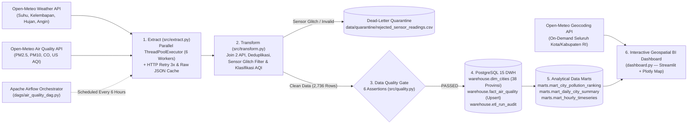
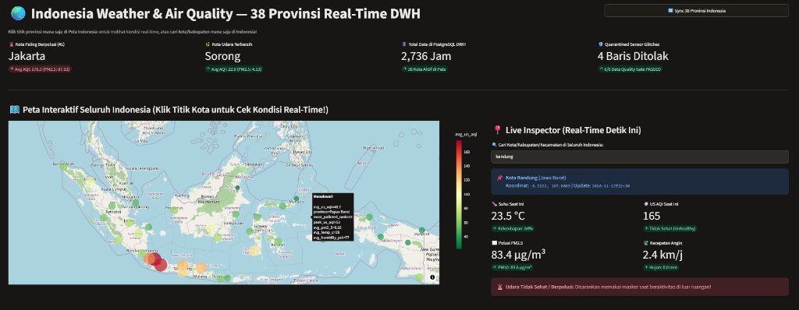
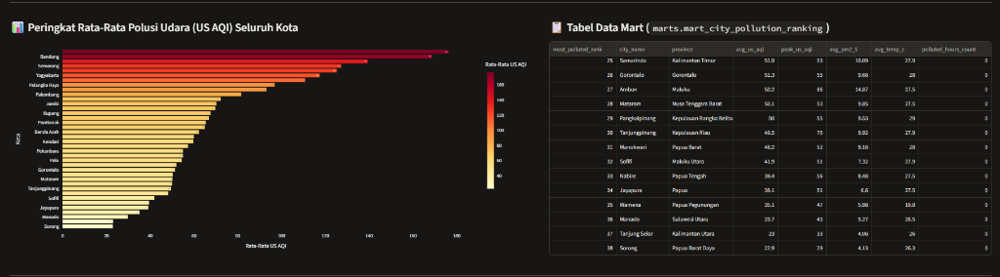
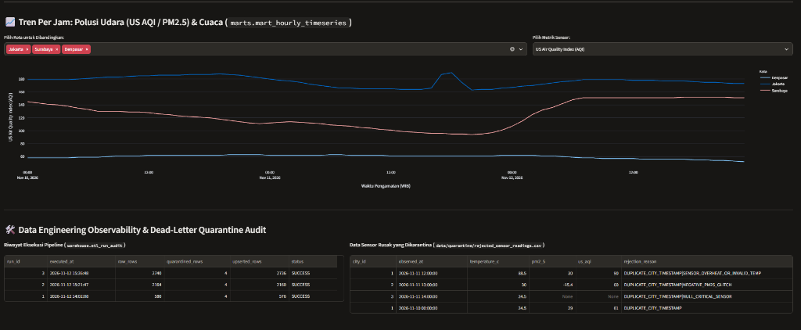
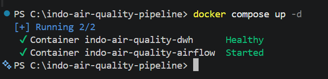

# Indonesia Weather & Air Quality Monitoring Data Pipeline (38 Provinsi)

> **End-to-End Public API ETL Pipeline, PostgreSQL 15 Star Schema Data Warehouse, Apache Airflow Orchestration & Interactive Geospatial BI Dashboard**  
> Mengekstrak data cuaca dan polusi udara (`PM2.5`, `PM10`, `CO`, `US AQI`) secara *real-time* dari **Open-Meteo REST API** untuk **seluruh 38 Provinsi di Indonesia** (2.736 jam observasi per *batch*), dilengkapi **Parallel Ingestion (`ThreadPoolExecutor`)**, **Dead-Letter Quarantine (`rejected_sensor_readings.csv`)**, **Automated Data Quality Gate (`pytest`)**, **Incremental Upsert (`ON CONFLICT DO UPDATE`)** ke **PostgreSQL 15 Data Warehouse**, orkestrasi otomatis **Apache Airflow (Docker)**, serta **Interactive Geospatial Map & Real-Time City Inspector Dashboard (`Streamlit` + `Plotly`)**.

---

## 1. Arsitektur Data Pipeline



---

## 2. Fitur Utama Data Engineering

1. **Parallel Multi-Endpoint API Ingestion (`src/extract.py`):**
   - Mengambil data 72 jam terakhir dari 2 endpoint REST API berbeda untuk **38 ibu kota provinsi di seluruh Indonesia** (Aceh hingga Papua Selatan, termasuk provinsi pemekaran baru).
   - Menggunakan **`ThreadPoolExecutor(max_workers=6)`** untuk ekstraksi paralel berkecepatan tinggi, dilengkapi **HTTP Connection Pooling & Exponential Backoff Retry (`urllib3.Retry`)**, serta mekanisme *Raw JSON Cache Fallback*.
2. **Data Transformation & Dead-Letter Quarantine (`src/transform.py`):**
   - Menggabungkan (*inner join*) array JSON cuaca dan polusi udara berdasarkan waktu pengamatan (`observed_at`) dan `city_id`.
   - Mendeteksi *IoT sensor glitches* (duplikasi timestamp, suhu ekstrem di luar batas wajar Indonesia, nilai `PM2.5` negatif, dan sensor kritis `NULL`) lalu memisahkannya ke **Dead-Letter Quarantine (`data/quarantine/rejected_sensor_readings.csv`)** beserta alasan penolakannya (`rejection_reason`) tanpa menghentikan *pipeline*.
   - Mengklasifikasikan angka `us_aqi` ke dalam kategori kesehatan udara (`Baik`, `Sedang`, `Tidak Sehat bagi Sensitif`, `Tidak Sehat`, `Sangat Tidak Sehat`).
3. **Automated Data Quality Gate & Unit Testing (`src/quality.py` & `tests/test_air_quality.py`):**
   - Memeriksa 6 aturan kualitas data otomatis (keunikan *Primary Key* & *Composite Key*, kelengkapan sensor kritis, kewajaran rentang suhu Indonesia $8^\circ\text{C}\text{–}45^\circ\text{C}$ termasuk dataran tinggi Wamena/Papua Pegunungan, nilai polusi non-negatif, dan *Foreign Key Integrity*) serta menyimpan laporan audit ke `logs/dq_report.json`.
   - Dilengkapi *unit & integration test suite* menggunakan **Pytest**.
4. **Incremental Upsert Star Schema Warehouse & Audit Logging (`sql/init_schema.sql` & `src/load.py`):**
   - Menggunakan pola **`INSERT ... ON CONFLICT (city_id, observed_at) DO UPDATE`** pada PostgreSQL 15 sehingga *pipeline* bersifat *idempotent* dan mendukung *historical accumulation* tanpa duplikasi data.
   - Mencatat metrik observabilitas setiap eksekusi (*raw rows*, *quarantined rows*, *upserted rows*, status) ke tabel **`warehouse.etl_run_audit`**.
5. **Interactive Geospatial Map & Real-Time City Inspector (`dashboard.py`):**
   - Visualisasi peta interaktif **38 Provinsi Indonesia** menggunakan `Plotly OpenStreetMap` & `Streamlit`: klik titik kota mana saja di peta untuk melihat suhu, kelembapan, curah hujan, kecepatan angin, `PM2.5`, dan `US AQI` secara langsung.
   - Dilengkapi fitur **Pencarian Kota/Kabupaten/Kecamatan Seluruh Indonesia** yang terhubung langsung secara *real-time* ke Open-Meteo Geocoding, Weather & Air Quality API.
6. **Automated Workflow Orchestration (`dags/air_quality_dag.py`):**
   - Menggunakan **Apache Airflow** (`indo_air_quality_monitoring_dag`) untuk menjadwalkan 4 task (`extract_open_meteo_api >> transform_weather_and_aqi >> run_data_quality_gate >> load_postgres_star_schema`) setiap 6 jam secara otomatis.

---

## 3. Cuplikan Analisis Data Mart (`marts.mart_city_pollution_ranking` — 38 Provinsi)

Hasil pemantauan **2.736 jam pengamatan** cuaca & polusi udara di 38 ibu kota provinsi Indonesia (Top 5 Kota Paling Berpolusi vs Top 5 Kota Udara Terbersih):

| Kategori | Rank | Kota | Provinsi | Jam Dipantau | Avg US AQI | Peak US AQI | Avg PM2.5 (µg/m³) | Avg Suhu (°C) |
| :--- | ---: | :--- | :--- | ---: | ---: | ---: | ---: | ---: |
| **Paling Berpolusi** | 1 | **Jakarta** | DKI Jakarta | 72 | 176.3 | 190 | 87.32 | 28.6 |
| **Paling Berpolusi** | 2 | **Bandung** | Jawa Barat | 72 | 168.5 | 182 | 80.52 | 25.0 |
| **Paling Berpolusi** | 3 | **Serang** | Banten | 72 | 139.2 | 162 | 51.31 | 28.4 |
| **Paling Berpolusi** | 4 | **Semarang** | Jawa Tengah | 72 | 126.9 | 192 | 39.29 | 28.8 |
| **Paling Berpolusi** | 5 | **Surabaya** | Jawa Timur | 72 | 124.7 | 152 | 44.38 | 29.8 |
| **Udara Terbersih** | 34 | **Jayapura** | Papua | 72 | 39.1 | 51 | 6.60 | 27.5 |
| **Udara Terbersih** | 35 | **Wamena** | Papua Pegunungan | 72 | 35.1 | 47 | 5.98 | 19.8 |
| **Udara Terbersih** | 36 | **Manado** | Sulawesi Utara | 72 | 29.7 | 43 | 5.27 | 28.5 |
| **Udara Terbersih** | 37 | **Tanjung Selor** | Kalimantan Utara | 72 | 23.0 | 33 | 4.06 | 28.0 |
| **Udara Terbersih** | 38 | **Sorong** | Papua Barat Daya | 72 | 22.9 | 29 | 4.13 | 28.3 |

---

## 4. Dokumentasi Visual Hasil Eksekusi (Screenshots)

### 1. Interactive 38-Province Geospatial Map & Live City Inspector (`dashboard.py`)



### 2. Peringkat Polusi 38 Provinsi & Tabel Data Mart (`marts.mart_city_pollution_ranking`)



### 3. Tren Time-Series Per Jam & Audit Observability (`warehouse.etl_run_audit` & Dead-Letter Quarantine)



### 4. Apache Airflow DAG Orchestration (`indo_air_quality_monitoring_dag` — 4 Tasks Success)


### 5. Automated Unit & Integration Testing (`pytest -v` — 3 Passed)


### 6. Containerized Infrastructure (`indo-air-quality-dwh` & `indo-air-quality-airflow`)



### 7. API Data Ingestion Execution (`src/extract.py`)


---

## 5. Cara Menjalankan Proyek

```bash
# 1. Nyalakan container PostgreSQL 15 DWH (port 5434) & Apache Airflow (port 8086)
docker compose up -d

# 2. Instal dependensi Python
pip install -r requirements.txt

# 3. Jalankan End-to-End ETL Pipeline (38 Provinsi Indonesia)
python run_pipeline.py

# 4. Jalankan Automated Unit & Integration Tests
python -m pytest -v

# 5. Jalankan Interactive Geospatial BI Dashboard (Streamlit + Plotly)
python -m streamlit run dashboard.py
# URL Dashboard: http://localhost:8501

# 6. Akses Apache Airflow Web UI di browser
# URL Airflow: http://localhost:8086 (Login: admin / admin)
```
